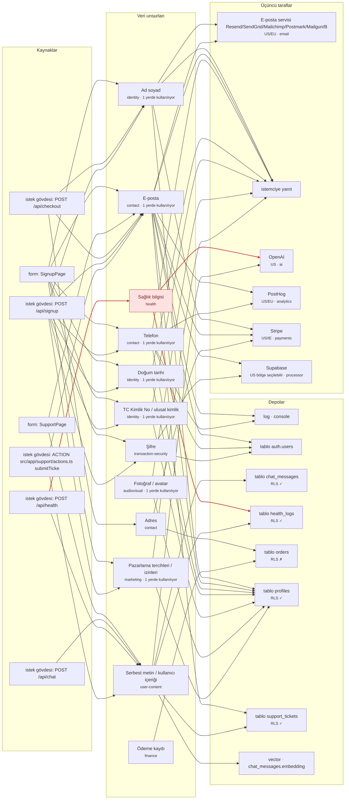

# KVKK / GDPR Denetim Raporu

_Veri akışı analizi ve ilke bazlı hukuki değerlendirme_

**Uyum skoru: 0/100 (F)** · audit-app · 17 dosya

**Kapsam notları:**

- Next.js: destekleniyor; daha önce görülmemiş 8 projede 253 maddeden 214 tanesi doğruydu, proje başına ortalama 5 sorun kaçırıldı

**Analiz kapsamı (katmanlar)** · _Tespit edilen teknolojiler: Supabase (Postgres)_

| Katman | Durum | Bulunan | Eksik |
|---|---|---|---|
| Veritabanı şeması | ✓ bulundu | 5 tablo (30 sütun) + 1 depolama alanı | — |
| API uç noktaları | ✓ bulundu | 6 | — |
| Veritabanı yazma | ✓ bulundu | 12 | — |
| Formlar / kaynaklar | ✓ bulundu | 9 | — |
| Arayüz | ✓ bulundu | 5 | — |
| Üçüncü taraflar | ✓ bulundu | 5 | — |
| Aydınlatma metinleri | ✓ bulundu | 1 | — |

| 🛑 KRİTİK | 🔴 YÜKSEK | 🟠 ORTA | 🟡 DÜŞÜK | 🔵 BİLGİ |
|---|---|---|---|---|
| 1 | 1 | 12 | 1 | 0 |

## Yönetici özeti

- 🛑 **Yurt dışına kişisel veri aktarımı** — OpenAI (US) ← Serbest metin / kullanıcı içeriği, Sağlık bilgisi
- 🔴 **Veri koruma etki değerlendirmesi (DPIA) gerekli görünüyor** — Özel nitelikli veya çok kişisel veri

# 📦 Envanter

_Olgu, hüküm yok: kişisel veriler, işleme faaliyetleri, üçüncü taraflar ve yurt dışı aktarım. Listelenenler büyük oranda doğrudur, ama liste tam değildir: eksik veri ya da alıcı olabilir._

## Veri haritası

## Kişisel veri envanteri

| Veri unsuru | Kategori | Hassasiyet | Kaynak | Saklandığı yer | Aktarıldığı taraf | Kullanılıyor mu |
|---|---|---|---|---|---|---|
| Ad soyad | Kimlik | normal | form: SignupPage, istek gövdesi: POST /api/checkout, istek gövdesi: POST /api/signup | profiles.full_name | Stripe, istemciye yanıt, E-posta servisi (Resend/SendGrid/Mailchimp/Postmark/Mailgun/Brevo) | ✓ |
| E-posta | İletişim | normal | form: SignupPage, form: SupportPage, istek gövdesi: POST /api/checkout, istek gövdesi: POST /api/signup, istek gövdesi: ACTION src/app/support/actions.ts#submitTicket | tablo auth.users, profiles.email, log · console, support_tickets.email, auth.users.email | Stripe, istemciye yanıt, Supabase, E-posta servisi (Resend/SendGrid/Mailchimp/Postmark/Mailgun/Brevo), PostHog | ✓ |
| Telefon | İletişim | normal | form: SignupPage, istek gövdesi: POST /api/signup | profiles.phone, log · console, auth.users.phone | istemciye yanıt, PostHog | ✓ |
| Doğum tarihi | Kimlik | normal | form: SignupPage, istek gövdesi: POST /api/signup | profiles.birth_date | istemciye yanıt | ⚠ kullanım tespit edilmedi |
| TC Kimlik No / ulusal kimlik | Kimlik | yüksek | form: SignupPage, istek gövdesi: POST /api/signup | profiles.tckn | istemciye yanıt | ⚠ kullanım tespit edilmedi |
| Fotoğraf / avatar | Görsel ve İşitsel Kayıtlar | normal | — | profiles.avatar_url | istemciye yanıt | ⚠ kullanım tespit edilmedi |
| Pazarlama tercihleri / izinleri | Pazarlama | normal | form: SignupPage, istek gövdesi: POST /api/signup | profiles.marketing_opt_in | istemciye yanıt | ⚠ kullanım tespit edilmedi |
| Sağlık bilgisi | Sağlık Bilgileri | 🩺 özel nitelikli | istek gövdesi: POST /api/health | health_logs.symptoms, health_logs.mood | OpenAI | ✓ |
| Serbest metin / kullanıcı içeriği | Kullanıcı İçeriği (serbest metin) | normal | form: SupportPage, istek gövdesi: POST /api/chat, istek gövdesi: POST /api/health, istek gövdesi: ACTION src/app/support/actions.ts#submitTicket | chat_messages.content, chat_messages.embedding, vector · chat_messages.embedding, health_logs.notes, support_tickets.message | OpenAI | ✓ |
| Adres | İletişim | normal | istek gövdesi: POST /api/checkout | orders.shipping_address | Stripe | ✓ |
| Ödeme kaydı | Finans | normal | — | orders.stripe_customer_id | — | ⚠ kullanım tespit edilmedi |
| Şifre | İşlem Güvenliği | yüksek | form: SignupPage, istek gövdesi: POST /api/signup | tablo auth.users, auth.users.encrypted_password | Supabase | ✓ |

## İşleme faaliyetleri (ROPA)

| Amaç | Önerilen hukuki sebep | Veriler | Alıcılar | Saklama |
|---|---|---|---|---|
| Üyelik ve hesap yönetimi | Sözleşmenin kurulması/ifası (KVKK md.5/2-c; GDPR Art.6(1)(b)) | full_name, email, phone, birth_date, national_id, photo, marketing_consent, password | — | ✗ |
| Ödeme ve faturalandırma | Sözleşmenin kurulması/ifası (KVKK md.5/2-c; GDPR Art.6(1)(b)) Hukuki yükümlülük (KVKK md.5/2-ç; GDPR Art.6(1)(c)) | email, full_name, address | Stripe | ✗ |
| Ürün analitiği ve kullanım ölçümü | Açık rıza (KVKK md.5/1; GDPR Art.6(1)(a)) | email, phone | PostHog | — |
| Pazarlama ve ticari elektronik ileti | Açık rıza (KVKK md.5/1; GDPR Art.6(1)(a)) | marketing_consent | — | ✗ |
| Yapay zekâ destekli özellikler | Sözleşmenin kurulması/ifası (KVKK md.5/2-c; GDPR Art.6(1)(b)) Özel nitelikli veri için açık rıza (veya md.6/3 diğer şartları) (KVKK md.6/3-a; GDPR Art.9(2)(a)) | free_text, health | OpenAI | — |
| Müşteri destek ve iletişim | Sözleşmenin kurulması/ifası (KVKK md.5/2-c; GDPR Art.6(1)(b)) Meşru menfaat (KVKK md.5/2-f; GDPR Art.6(1)(f)) | email, free_text | — | ✗ |
| Sağlık / iyi oluş özelliği | Özel nitelikli veri için açık rıza (veya md.6/3 diğer şartları) (KVKK md.6/3-a; GDPR Art.9(2)(a)) | health, free_text | — | ✗ |
| Güvenlik ve sistem kayıtları | Hukuki yükümlülük (KVKK md.5/2-ç; GDPR Art.6(1)(c)) Meşru menfaat (KVKK md.5/2-f; GDPR Art.6(1)(f)) | email, phone | — | ✗ |
| Profil fotoğrafı ve dosya depolama | Sözleşmenin kurulması/ifası (KVKK md.5/2-c; GDPR Art.6(1)(b)) |  | — | ✗ |

## Yurt dışı aktarım kaydı

| Servis | Ülke | Yurt dışı (KVKK) | Üçüncü ülke (GDPR) | Veriler |
|---|---|---|---|---|
| OpenAI | US | ✓ | ✓ | Serbest metin / kullanıcı içeriği, Sağlık bilgisi 🩺 |
| Stripe | US/IE | ✓ | ✓ | E-posta, Ad soyad, Adres |
| Supabase _(veritabanı barındırma)_ | US (bölge seçilebilir) | ✓ | ✓ | E-posta, Şifre, Ad soyad, Telefon, Doğum tarihi, TC Kimlik No / ulusal kimlik, Fotoğraf / avatar, Pazarlama tercihleri / izinleri, Sağlık bilgisi, Serbest metin / kullanıcı içeriği, Adres, Ödeme kaydı 🩺 |
| Resend | US | ✓ | ✓ | E-posta, Ad soyad |
| PostHog | US/EU | ✓ | ✓ | E-posta, Telefon |

### Otomatik temizliği olmayan tablolar

_Olgu, hüküm yok: bu depolar için kodda süresi dolanı silen bir iş (cron, TTL, döndürme) görülmedi. Çoğu hesap ömrü boyunca saklanır ve bu meşrudur; süresiz kalmaması gerekenler (IP / tarayıcı kayıtları, loglar, davetler, silinen kayıtlar) için saklama süresi belirleyip uygulayın._

- tablo profiles (Ad soyad, E-posta, Telefon, Doğum tarihi, TC Kimlik No / ulusal kimlik, Fotoğraf / avatar, Pazarlama tercihleri / izinleri) — `supabase/migrations/0001_init.sql:2`
- tablo health_logs (Sağlık bilgisi, Serbest metin / kullanıcı içeriği) — `supabase/migrations/0001_init.sql:17`
- tablo orders (Adres, Ödeme kaydı) — `supabase/migrations/0001_init.sql:29`
- tablo support_tickets (E-posta, Serbest metin / kullanıcı içeriği) — `supabase/migrations/0001_init.sql:39`
- tablo chat_messages (Serbest metin / kullanıcı içeriği) — `supabase/migrations/0001_init.sql:48`
- vector · chat_messages.embedding (Serbest metin / kullanıcı içeriği)
- log · console (E-posta, Telefon) — `src/app/api/signup/route.ts:18`

# ⚖️ Kontrol edilecekler

_Hüküm içeren bulgular; her kuralın yanında ölçülen isabet var. Her birini kodda doğrulayın._

## Bulgular

_Kalibrasyon: her konumun yanında, aynı alt sinyalin daha önce hiç görülmemiş projelerde bağımsız olarak etiketlenmiş sonuçlarından ölçülen ilk görüş isabeti yer alır (TP/FP, proje sayısı). Ölçülen isabeti güvenilir biçimde düşük olan sinyaller puana katılmaz, "Doğrulanmalı" listesine taşınır; "yetersiz veri" az sayıda etiket, "ölçülmedi" henüz ölçüm olmadığı anlamına gelir. Skor yalnızca puanlanan bulgulardan hesaplanır._

### 🔐 Güvenlik

#### 🟠 Kişisel veri tutan tablolar herkese açık `AUD-SEC-01` (özgün önem: KRİTİK)

İsabet: 84 projelik ölçüm setinde %75 (12/16) · gerçek projelerde ölçülmedi · önem "orta" ile sınırlandı: bu kural için gerçek projelerde yeterli isabet ölçülmedi

- 🟠 health_logs: "read all logs" politikası herkese select izni veriyor (Sağlık bilgisi, Serbest metin / kullanıcı içeriği) — `supabase/migrations/0001_init.sql:26`
  - Kalibrasyon: ölçülen isabet %40 (2/3, 5 proje) — güçlü kanıtla tutuldu: Satırlar şema düzeyinde bir kişiye bağlı (kullanıcı tablosu / yabancı anahtar / sahiplik sütunu)
- 🟠 orders: RLS kapalı — anon anahtarı ile okunabilir/yazılabilir (Adres, Ödeme kaydı) — `supabase/migrations/0001_init.sql:29`
  - Kalibrasyon: yetersiz veri (1/0)

**Neden önemli:** Bu tablolarda RLS kapalı ya da politika sahiplik kontrolü yapmıyor. Supabase'de anon anahtarı istemci kodunda herkese açıktır; yani bu satırları herkes okuyabilir. Yetkisiz erişim gerçekleştiyse bu bir veri ihlalidir (KVKK md.12/5, GDPR Art.4(12)) ve 72 saat içinde bildirim gerekebilir; erişim kayıtlarını inceleyin.

**Ne yapmalı:** ALTER TABLE … ENABLE ROW LEVEL SECURITY; ve USING (auth.uid() = user_id) gibi sahiplik politikaları yazın. Herkese açık olması gereken veriyi ayrı bir tabloya/view'a taşıyın.

Dayanak: KVKK md.12/1 · KVKK md.12/5 · GDPR Art.25 · GDPR Art.32 · GDPR Art.33

#### 🟠 Yetkisiz erişime açık uç noktalar `AUD-SEC-03` (özgün önem: KRİTİK)

İsabet: 7 gerçek projede (ayar seti) isabet %23 (21/90) · 84 projelik ölçüm setinde %57 (72/126) · önem "orta" ile sınırlandı: bu kural için gerçek projelerde yeterli isabet ölçülmedi

- 🟠 POST /api/health: "userId" istek gövdesinden alınıyor ve oturumdaki kullanıcıyla karşılaştırılmıyor; başka bir kullanıcının kaydı değiştirilebilir (IDOR) — `src/app/api/health/route.ts:6`
  - Kalibrasyon: ölçülen isabet %76 (35/11, 6 proje)

**Neden önemli:** Bu API uç noktaları oturum kontrolü yapmadan veya kaydın isteği yapan kullanıcıya ait olduğunu doğrulamadan kişisel veri okuyor/yazıyor. Saldırgan başkası adına veri yazabilir veya başkasının verisini okuyabilir.

**Ne yapmalı:** Her handler'da oturumu sunucuda doğrulayın (supabase.auth.getUser()) ve kullanıcı ID'sini istek gövdesinden değil oturumdan alın; yetkisiz durumda hata yanıtından sonra return/throw ile handler'ı durdurun; middleware rota listelerini gerçek yollarla birebir eşleştirin; servis anahtarı (service_role) kullanılan yerlerde sahipliği elle kontrol edin.

Dayanak: KVKK md.12 · GDPR Art.32 · OWASP API1:2023 BOLA

⚠️ doğrulanmamış dayanak: OWASP API1:2023 BOLA (docs/hukuki-dayanaklar.md)

#### 🟠 Kişisel veri log kayıtlarına yazılıyor `AUD-SEC-04`

İsabet: 7 gerçek projede (ayar seti) isabet %32 (6/19) · 84 projelik ölçüm setinde %67 (48/72)

- 🟠 E-posta → log · console — `src/app/api/signup/route.ts:18`
  - Veri yolu: istek gövdesi: POST /api/signup → E-posta → log · console
  - Kalibrasyon: ölçülen isabet %97 (28/1, 15 proje)
- 🟠 Telefon → log · console — `src/app/api/signup/route.ts:18`
  - Veri yolu: istek gövdesi: POST /api/signup → Telefon → log · console
  - Kalibrasyon: ölçülen isabet %97 (28/1, 15 proje)

**Neden önemli:** Loglar genellikle şifrelenmez, geniş ekiplerce görülür, üçüncü taraf log servislerine (Vercel, Sentry, Datadog) aktarılır ve silme taleplerinin kapsamı dışında kalır.

**Ne yapmalı:** Log'a kullanıcı ID'si yazın; e-posta/telefon gibi alanları maskeleyin veya hiç yazmayın. Log saklama süresini sınırlayın.

Dayanak: KVKK md.4/2-ç · KVKK md.12 · GDPR Art.5(1)(c) · GDPR Art.32

### ✋ Rıza

#### 🟠 Rıza arayüzünde "Reddet" seçeneği yok `AUD-LB-02`

İsabet: isabet ölçülmedi

- 🟠 Çerez banner'ı: "Kabul et" var, "Reddet" yok — `src/components/CookieBanner.tsx:5`
  - Kalibrasyon: ölçülmedi

**Neden önemli:** KVKK Çerez Rehberi eşit belirginlikte "kabul et", "reddet" ve "tercihler" butonlarını iyi uygulama örneği olarak gösterir, zorunluluk olarak yazmaz. Yalnızca "Kabul et" sunan bir banner'da rızanın özgür iradeyle verildiği tartışmalıdır; GDPR Art.7(3) rızayı geri almanın vermek kadar kolay olmasını ister.

**Ne yapmalı:** İlk katmana aynı görünürlükte "Reddet" ve "Tercihler" butonları ekleyin.

Dayanak: KVKK Çerez Rehberi (2025) · GDPR Art.7(3) · EDPB Cookie Banner Taskforce Report (2023)

⚠️ doğrulanmamış dayanak: EDPB Cookie Banner Taskforce Report (2023) (docs/hukuki-dayanaklar.md)

#### 🟠 Pazarlama rızası varsayılan olarak verilmiş `AUD-LB-03`

İsabet: isabet ölçülmedi

- 🟠 form: SignupPage: önceden işaretli onay kutusu (marketing) — `src/app/signup/page.tsx:10`
  - Kalibrasyon: ölçülmedi
- 🟠 profiles.marketing_opt_in varsayılan değeri true (rıza varsayılan olarak verilmiş) — `supabase/migrations/0001_init.sql:10`
  - Kalibrasyon: ölçülmedi

**Neden önemli:** Önceden işaretli kutular veya "default true" kolonlar, kullanıcının aktif bir eylemi olmadan rıza varsayar. Bu geçerli açık rıza değildir (Planet49) ve ticari elektronik iletide 6563 sayılı Kanun'a aykırıdır.

**Ne yapmalı:** Kutuyu boş başlatın, kolon varsayılanını false yapın; onayı zaman damgası ve metin versiyonuyla kaydedip İYS'ye iletin.

Dayanak: KVKK md.3 · KVKK md.5/1 · 6563 s. Kanun md.6 · GDPR Art.4(11) · GDPR Art.7 · CJEU C-673/17 Planet49

### 📄 Şeffaflık

#### 🟠 Aydınlatma metni gerçekte olanla örtüşmüyor `AUD-TRN-02` (özgün önem: YÜKSEK)

İsabet: 7 gerçek projede (ayar seti) isabet %15 (2/13) · 84 projelik ölçüm setinde %62 (31/50) · önem "orta" ile sınırlandı: bu kural için gerçek projelerde yeterli isabet ölçülmedi

- 🟠 İşleniyor ama aydınlatma metninde yok: Sağlık bilgisi — `src/app/privacy/page.tsx:1`
  - Kalibrasyon: ölçülen isabet %68 (19/9, 7 proje) — güçlü kanıtla tutuldu: Ayrı bir gizlilik politikası sayfası desteklenen bir dilde okundu; bu doğrudan tanımlayıcı / özel nitelikli veri bir depoya veya servise kadar izlendi ve metinde geçmiyor.
- 🟠 Veri gönderiliyor ama alıcı olarak belirtilmemiş: OpenAI (Serbest metin / kullanıcı içeriği, Sağlık bilgisi) — `src/app/privacy/page.tsx:1`
  - Kalibrasyon: ölçülen isabet %92 (11/1, 7 proje)
- 🟠 İşleniyor ama aydınlatma metninde yok: TC Kimlik No / ulusal kimlik — `src/app/privacy/page.tsx:1`
  - Kalibrasyon: ölçülen isabet %68 (19/9, 7 proje) — güçlü kanıtla tutuldu: Ayrı bir gizlilik politikası sayfası desteklenen bir dilde okundu; bu doğrudan tanımlayıcı / özel nitelikli veri bir depoya veya servise kadar izlendi ve metinde geçmiyor.
- 🟠 Veri gönderiliyor ama alıcı olarak belirtilmemiş: Resend (E-posta, Ad soyad) — `src/app/privacy/page.tsx:1`
  - Kalibrasyon: ölçülen isabet %92 (11/1, 7 proje)
- 🟠 Veri gönderiliyor ama alıcı olarak belirtilmemiş: PostHog (E-posta, Telefon) — `src/app/privacy/page.tsx:1`
  - Kalibrasyon: ölçülen isabet %92 (11/1, 7 proje)
- 🟡 İşleniyor ama aydınlatma metninde yok: Fotoğraf / avatar — `src/app/privacy/page.tsx:1`
  - Kalibrasyon: ölçülen isabet %68 (19/9, 7 proje) — güçlü kanıtla tutuldu: Ayrı bir gizlilik politikası sayfası desteklenen bir dilde okundu; bu doğrudan tanımlayıcı / özel nitelikli veri bir depoya veya servise kadar izlendi ve metinde geçmiyor.
- 🟡 İşleniyor ama aydınlatma metninde yok: Adres — `src/app/privacy/page.tsx:1`
  - Kalibrasyon: ölçülen isabet %68 (19/9, 7 proje) — güçlü kanıtla tutuldu: Ayrı bir gizlilik politikası sayfası desteklenen bir dilde okundu; bu doğrudan tanımlayıcı / özel nitelikli veri bir depoya veya servise kadar izlendi ve metinde geçmiyor.

**Neden önemli:** Aydınlatma metni/gizlilik politikası ile kodun gerçekte topladığı veriler ve aktardığı taraflar karşılaştırıldı. Eksik veya yanlış aydınlatma, aydınlatma yükümlülüğünün ihlalidir (md.18 idari para cezası); yanlış "yurt dışı aktarım yok" beyanı ayrıca md.9 ihlalini gizler.

**Ne yapmalı:** Metni güncelleyin: tüm veri kategorilerini, amaçları, alıcı gruplarını (yapay zekâ ve analitik sağlayıcıları dahil) ve yurt dışı aktarımları yazın. `kvkk-check docs` tespit edilenlerle bir taslak üretir.

Dayanak: KVKK md.10 · Aydınlatma Yükümlülüğü Tebliği · KVKK md.18/1-a · GDPR Art.12 · GDPR Art.13

### 🌍 Üçüncü taraflar & yurt dışı aktarım

#### 🛑 Yurt dışına kişisel veri aktarımı `AUD-TRF-01`

İsabet: 7 gerçek projede (ayar seti) isabet %86 (43/50) · 84 projelik ölçüm setinde %87 (97/111)

- 🛑 OpenAI (US) ← Serbest metin / kullanıcı içeriği, Sağlık bilgisi — `src/app/api/chat/route.ts:10`
  - Kalibrasyon: ölçülen isabet %96 (49/2, 36 proje)
- 🔴 Supabase (US (bölge seçilebilir)) ← E-posta, Şifre, Ad soyad, Telefon, Doğum tarihi, TC Kimlik No / ulusal kimlik, Fotoğraf / avatar, Pazarlama tercihleri / izinleri, Sağlık bilgisi, Serbest metin / kullanıcı içeriği, Adres, Ödeme kaydı — `src/app/api/signup/route.ts:8`
  - Kalibrasyon: ölçülen isabet %96 (49/2, 36 proje)
- 🟠 Stripe (US/IE) ← E-posta, Ad soyad, Adres — `src/app/api/checkout/route.ts:8`
  - Kalibrasyon: ölçülen isabet %96 (49/2, 36 proje)
- 🟠 Resend (US) ← E-posta, Ad soyad — `src/app/api/signup/route.ts:19`
  - Kalibrasyon: ölçülen isabet %96 (49/2, 36 proje)

**Neden önemli:** Aşağıdaki servisler kişisel veriyi Türkiye dışında işliyor. KVKK md.9 (2024) uyarınca yeterlilik kararı bulunmadığından her biri için uygun güvence gerekir: genellikle Kurul'un standart sözleşmesi imzalanmalı ve imzadan itibaren 5 iş günü içinde Kurum'a bildirilmelidir. AB kullanıcıları için GDPR Ch.V (SCC/DPF) geçerlidir. Özel nitelikli veri ve yapay zekâ sağlayıcıları en yüksek önceliktedir. Konumu bilinmeyen alıcıların nerede barındırıldığı doğrulanmalıdır.

**Ne yapmalı:** Her servis için: DPA imzalayın, mümkünse AB/TR bölgesi seçin, KVKK standart sözleşmesini imzalayıp bildirin, aydınlatma metninde alıcı grubunu ve aktarımı belirtin; LLM sağlayıcılarında veri saklamayı/eğitimi kapatın.

Dayanak: KVKK md.9 · GDPR Art.28 · GDPR Art.44 · GDPR Art.46

⚠️ doğrulanmamış dayanak: “Yeterlilik kararı bulunmuyor” (docs/hukuki-dayanaklar.md)

### 🙋 İlgili kişi hakları

#### 🟠 Yapay zekâ ile kişi hakkında otomatik değerlendirme `AUD-ADM-01`

İsabet: 84 projelik ölçüm setinde yetersiz veri: 1 konumda 1 doğru · gerçek projelerde ölçülmedi

- 🟠 OpenAI Sağlık bilgisi verisiyle kişiye yönelik çıktı üretiyor (POST /api/chat, POST /api/health) — `src/app/api/chat/route.ts:10`
  - Kalibrasyon: ölçülmedi

**Neden önemli:** Bir LLM, kişinin sağlık vb. verilerinden ona özel tavsiye/değerlendirme üretiyor. Münhasıran otomatik analiz sonucu aleyhe bir sonuç doğarsa kişinin itiraz hakkı vardır; AB'de hukuki/benzeri etkili kararlar Art.22 kapsamındadır ve kullanıcıya yapay zekâ ile etkileşimde olduğu bildirilmelidir (AI Act Art.50).

**Ne yapmalı:** Çıktının bilgilendirme amaçlı olduğunu ve yapay zekâ ürettiğini açıkça belirtin, insan incelemesi/itiraz kanalı sunun, sağlık tavsiyesi niteliğindeyse tıbbi cihaz/sorumluluk boyutunu değerlendirin.

Dayanak: KVKK md.11/1-g · GDPR Art.22 · EU AI Act Art.50

#### 🟡 İlgili kişi haklarının teknik karşılığı eksik `AUD-DSR-01`

İsabet: 7 gerçek projede (ayar seti) yetersiz veri: 3 konumda 1 doğru · 84 projelik ölçüm setinde %89 (55/62)

- 🟡 Veri erişim / dışa aktarma (verilerimi indir) akışı bulunamadı
  - Kalibrasyon: ölçülen isabet %98 (49/1, 51 proje)

**Neden önemli:** Kullanıcılar verilerine erişme, düzeltme ve (GDPR) taşınabilir formatta alma hakkına sahiptir; başvurular 30 gün içinde sonuçlandırılmalıdır.

**Ne yapmalı:** "Verilerimi indir" (JSON/CSV) ve profil düzenleme özelliği ekleyin veya en azından başvuru kanalını aydınlatma metninde belirtip manuel süreci tanımlayın.

Dayanak: KVKK md.11 · KVKK md.13 · GDPR Art.15 · GDPR Art.16 · GDPR Art.20

### 🩺 Özel nitelikli veri

#### 🟠 Özel nitelikli kişisel veri akışları `AUD-SPC-01` (özgün önem: KRİTİK)

İsabet: 84 projelik ölçüm setinde %73 (8/11) · gerçek projelerde ölçülmedi · önem "orta" ile sınırlandı: bu kural için gerçek projelerde yeterli isabet ölçülmedi

- 🟠 Sağlık bilgisi → health_logs.symptoms (herkese açık erişim!) — `src/app/api/health/route.ts:7`
  - Veri yolu: istek gövdesi: POST /api/health → Sağlık bilgisi → health_logs.symptoms
  - Kalibrasyon: yetersiz veri (3/2)
- 🟠 Sağlık bilgisi → OpenAI (US) — `src/app/api/health/route.ts:8`
  - Veri yolu: istek gövdesi: POST /api/health → Sağlık bilgisi → OpenAI
  - Kalibrasyon: yetersiz veri (1/0)

**Neden önemli:** Sağlık, biyometrik vb. özel nitelikli veriler aşağıdaki yerlere gidiyor. Bu veriler ancak KVKK md.6/3'teki şartlarla (çoğu uygulamada açık rıza) ve Kurul'un belirlediği ek önlemlerle işlenebilir; yurt dışındaki bir yapay zekâ sağlayıcısına gönderilmesi en yüksek risk grubundadır. Kodda özel nitelikli veri için ayrı bir açık rıza mekanizması bulunamadı.

**Ne yapmalı:** Önce gerekliliği sorgulayın. Gerekliyse: ayrı açık rıza alın ve kaydını tutun, veriyi şifreleyin, erişimi sahibine kısıtlayın, LLM'e göndermeden önce anonimleştirin/kaldırın veya veriyi Türkiye/AB içinde işleyen bir model kullanın, DPIA yapın.

Dayanak: KVKK md.6 · Kurul Kararı 2018/10 · GDPR Art.9 · GDPR Art.35

### ✂️ Veri minimizasyonu

#### 🟠 Toplanan ama kullanılmayan kişisel veri `AUD-MIN-01`

İsabet: 7 gerçek projede (ayar seti) isabet %0 (0/8) · 84 projelik ölçüm setinde %12 (4/34)

- 🟠 TC Kimlik No / ulusal kimlik: toplanıyor/saklanıyor (form: SignupPage, istek gövdesi: POST /api/signup, profiles.tckn) ama kodda hiç kullanılmıyor; sadece istemciye toplu olarak dönüyor — `supabase/migrations/0001_init.sql:8`
  - Kalibrasyon: ölçülen isabet %7 (1/14, 9 proje) — güçlü kanıtla tutuldu: Hassas kimlik/finans verisi bir istek gövdesi veya formla alınıp kişiye bağlı bir tablonun kolonunda saklanıyor; hiçbir yerde okunmuyor, sorguda kullanılmıyor, gösterilmiyor veya bir sağlayıcıya gönderilmiyor

**Neden önemli:** Bu veri unsurları formlardan/API'lerden alınıp saklanıyor ancak kod tabanında hiçbir işlemde kullanılmıyor. Amaçla bağlantılı, sınırlı ve ölçülü olma ilkesi gereği, belirli bir amaca hizmet etmeyen veri toplanmamalıdır. (Not: veri, kod dışından — ör. yönetim paneli — kullanılıyor olabilir; amacı belgeleyin.)

**Ne yapmalı:** Alanı formdan, API'den ve şemadan kaldırın; gerçekten gerekiyorsa amacını aydınlatma metninde belirtin ve daha az hassas bir alternatif düşünün (ör. doğum tarihi veya yaş yerine "18 yaşından büyüğüm" onayı).

Dayanak: KVKK md.4/2-ç · GDPR Art.5(1)(c) · GDPR Art.25(2)

### 🎯 Amaç sınırlaması

#### 🟠 Amaç kayması: hesap verisi analitik/pazarlama aracına gidiyor `AUD-PUR-01`

İsabet: 7 gerçek projede (ayar seti) yetersiz veri: 1 konumda 1 doğru

- 🟠 E-posta: üyelik/ödeme için toplanıp PostHog (analytics) aracına gönderiliyor — `src/components/Analytics.tsx:8`
  - Veri yolu: (ada göre çıkarım) E-posta → PostHog
  - Kalibrasyon: ölçülmedi
- 🟠 Telefon: üyelik/ödeme için toplanıp PostHog (analytics) aracına gönderiliyor — `src/components/Analytics.tsx:8`
  - Veri yolu: (ada göre çıkarım) Telefon → PostHog
  - Kalibrasyon: ölçülmedi

**Neden önemli:** Üyelik veya ödeme amacıyla toplanan doğrudan tanımlayıcılar (e-posta, telefon, ad) analitik/pazarlama araçlarına aktarılıyor. Bu, ilk toplama amacından farklı ve uyumsuz bir amaçtır; ayrı bir hukuki sebep (genellikle açık rıza) ve aydınlatma gerekir. Ayrıca kullanıcı platformlar arası eşleştirmeye açılır.

**Ne yapmalı:** Analitiğe sadece rastgele/dahili kullanıcı ID'si gönderin; e-posta/telefon göndermeyin. identify çağrısını rıza alındıktan sonra yapın.

Dayanak: KVKK md.4/2-c · KVKK md.5 · GDPR Art.5(1)(b) · GDPR Art.6(4)

### ⚖️ Hukuki sebep

#### 🟠 Rıza gerektiren işleme rıza alınmadan başlıyor `AUD-LB-01` (özgün önem: YÜKSEK)

İsabet: 7 gerçek projede (ayar seti) isabet %83 (5/6) · 84 projelik ölçüm setinde %86 (18/21) · önem "orta" ile sınırlandı: bu kural için gerçek projelerde yeterli isabet ölçülmedi

- 🟠 PostHog rıza kontrolü olmadan başlatılıyor; gönderilen veri: E-posta, Telefon — `src/components/Analytics.tsx:7`
  - Kalibrasyon: yetersiz veri (4/0)

**Neden önemli:** Bu araçlar çerez/cihaz tanımlayıcısı kullanır; reklam ve davranış izleme açık rıza gerektirir, kesinlikle gerekli olmayan diğerleri için de ePrivacy rıza arar. KVKK Çerez Rehberi (2025, 5.9), yalnızca kitle ölçümüyle sınırlı, siteler arası takip yapmayan birinci taraf analitiğin açık rıza dışında değerlendirilebileceğini söyler; aracın tespit ettiği sağlayıcının bu koşulları taşıyıp taşımadığını siz değerlendirmelisiniz. SDK, kullanıcı onay vermeden önce başlatılıyor (init rıza kontrolünün dışında). Banner olsa bile izleme onaydan önce başlamış olur.

**Ne yapmalı:** SDK init çağrısını rıza durumunu kontrol eden koşulun içine taşıyın (ör. if (consent.analytics) analytics.init(...)) veya SDK'yı devre dışı (opt-out) başlatıp onaydan sonra etkinleştirin.

Dayanak: KVKK md.5/1 · KVKK Çerez Rehberi (2025) · GDPR Art.6(1)(a) · GDPR Art.7 · ePrivacy Art.5(3)

### 🗑️ Silme kapsamı

#### 🟠 Silme işlemi verinin her kopyasına ulaşmıyor `AUD-DEL-02` (özgün önem: YÜKSEK)

İsabet: 7 gerçek projede (ayar seti) isabet %38 (23/61) · 84 projelik ölçüm setinde %42 (26/62) · önem "orta" ile sınırlandı: bu kural için gerçek projelerde yeterli isabet ölçülmedi

- 🟠 OpenAI: OpenAI tarafındaki kopya silinmiyor (API ile silme veya saklama süresi gerekli) — `src/app/api/chat/route.ts:10`
  - Kalibrasyon: ölçülen isabet %57 (4/3, 6 proje) — güçlü kanıtla tutuldu: OpenAI: tanımlayıcılar (health) yazma çağrısıyla gönderiliyor (src/app/api/health/route.ts:8)
- 🟠 tablo orders: profiles tablosuna referans var ama ON DELETE tanımsız (NO ACTION) — kullanıcı silinince veri kalır veya silme hata verir — `supabase/migrations/0001_init.sql:29`
  - Kalibrasyon: ölçülen isabet %48 (10/11, 8 proje) — güçlü kanıtla tutuldu: orders → profiles: son FK durumu ON DELETE tanımsız (SQL migrations replayed); tablo doğrudan tanımlayıcı tutuyor (address, payment_info)
- 🟠 Stripe: Stripe tarafındaki kopya silinmiyor (API ile silme veya saklama süresi gerekli) — `src/app/api/checkout/route.ts:8`
  - Kalibrasyon: ölçülen isabet %57 (4/3, 6 proje) — güçlü kanıtla tutuldu: Stripe: tanımlayıcılar (email, full_name, address) yazma çağrısıyla gönderiliyor (src/app/api/checkout/route.ts:8)
- 🟠 Resend: Resend tarafındaki kopya silinmiyor (API ile silme veya saklama süresi gerekli) — `src/app/api/signup/route.ts:19`
  - Kalibrasyon: ölçülen isabet %57 (4/3, 6 proje) — güçlü kanıtla tutuldu: Resend: tanımlayıcılar (email, full_name) yazma çağrısıyla gönderiliyor (src/app/api/signup/route.ts:19)
- 🟠 PostHog: PostHog tarafındaki kopya silinmiyor (API ile silme veya saklama süresi gerekli) — `src/components/Analytics.tsx:7`
  - Kalibrasyon: ölçülen isabet %57 (4/3, 6 proje) — güçlü kanıtla tutuldu: PostHog: tanımlayıcılar (email, phone) yazma çağrısıyla gönderiliyor (src/components/Analytics.tsx:8)

**Neden önemli:** Silme akışı (POST /api/account/delete) aşağıdaki depolara ve üçüncü taraflara ulaşmıyor. Kullanıcı "hesabımı sil" dediğinde bu veriler kalmaya devam eder; bu, silme talebinin eksik yerine getirilmesi demektir. Türetilmiş veriler (embedding'ler) ve yedekler de kapsama alınmalıdır.

**Ne yapmalı:** Bağlı kayıtları silin (yabancı anahtarlarda ON DELETE CASCADE), depolanan dosyaları silin, üçüncü taraf API'lerinde silme çağrısı yapın (Stripe customers.del, PostHog person delete, e-posta listesinden çıkarma) ve kalan veriyi anonimleştirin.

Dayanak: KVKK md.7 · Silme, Yok Etme veya Anonim Hale Getirme Yönetmeliği · KVKK md.11/1-e,f · GDPR Art.17 · GDPR Art.19

### 📊 Etki değerlendirmesi (DPIA)

#### 🔴 Veri koruma etki değerlendirmesi (DPIA) gerekli görünüyor `AUD-DPIA-01`

İsabet: 7 gerçek projede (ayar seti) isabet %14 (1/7) · 84 projelik ölçüm setinde %88 (14/16)

- 🔴 Özel nitelikli veya çok kişisel veri
  - Kalibrasyon: ölçülen isabet %100 (5/0, 5 proje)
- 🔴 Yenilikçi teknoloji (ör. yapay zekâ)
  - Kalibrasyon: ölçülen isabet %100 (5/0, 5 proje)
- 🟠 Veri setlerinin eşleştirilmesi/birleştirilmesi
  - Kalibrasyon: yetersiz veri (4/0)
- 🟠 Değerlendirme/puanlama, profilleme
  - Kalibrasyon: yetersiz veri (4/0)

**Neden önemli:** EDPB (WP248) ölçütlerinden 5 tanesi karşılanıyor; iki veya daha fazla ölçüt genellikle DPIA gerektirir. KVKK'da açık bir DPIA zorunluluğu yoktur ancak Kurul risk analizini md.12 kapsamında beklemektedir; AB kullanıcıları için GDPR Art.35 zorunludur.

**Ne yapmalı:** İşlemenin tanımı, gereklilik/ölçülülük, riskler ve önlemleri içeren bir DPIA hazırlayın; riskler azaltılamıyorsa denetim makamına danışın.

Dayanak: GDPR Art.35 · EDPB WP248 rev.01 · KVKK md.12

⚠️ doğrulanmamış dayanak: EDPB WP248 rev.01; “İki veya daha fazla WP248 ölçütü genellikle DPIA gerektirir” (docs/hukuki-dayanaklar.md)

## Doğrulanmalı (skora dahil değil)

_Bu maddeler puana katılmadı: ya aranan katman kapsanmadı, ya güven düşük, ya da bu sinyalin görülmemiş projelerdeki isabeti düşük veya henüz ölçülmedi. Önemli bir kısmı gerçek sorundur; elle doğrulayın._

**11:** 9 ölçülen düşük isabet, 1 kontrol doğrulama istedi, 1 henüz ölçülmemiş sinyal

### Muhtemelen gerçek (1)

#### ❔ Yurt dışına kişisel veri aktarımı `AUD-TRF-01`

- PostHog (US/EU) ← E-posta, Telefon — `src/components/Analytics.tsx:8`
  - ilk görüşte bu tür 51 konumdan 49 tanesi gerçekti
  - Neden doğrulanmalı: Aktarım yalnızca hiçbir yerden import edilmeyen modülde görülüyor (src/components/Analytics.tsx); bu kod çalışmıyor olabilir. Modülün kullanılıp kullanılmadığını doğrulayın.
  - Kalibrasyon: ölçülen isabet %96 (49/2, 36 proje)

⚠️ doğrulanmamış dayanak: “Yeterlilik kararı bulunmuyor” (docs/hukuki-dayanaklar.md)

### Belirsiz (9)

#### ❔ Aydınlatma metni gerçekte olanla örtüşmüyor `AUD-TRN-02`

- Metin "yurt dışına aktarılmamaktadır" diyor, ama veri şu servislere gidiyor: OpenAI (US), Stripe (US/IE), Supabase (US (bölge seçilebilir)), Resend (US), PostHog (US/EU) — `src/app/privacy/page.tsx:1`
  - ilk görüşte bu kuralın 50 konumdan 31 tanesi gerçekti
  - Neden doğrulanmalı: Doğrulanmalı: bu sinyal (TRN-02:transfer-contradiction) daha önce görülmemiş projelerde henüz ölçülmedi. Puana katılmadı; elle doğrulayın.
  - Kalibrasyon: ölçülmedi
- İşleniyor ama aydınlatma metninde yok: Doğum tarihi — `src/app/privacy/page.tsx:1`
  - ilk görüşte bu tür 28 konumdan 19 tanesi gerçekti
  - Neden doğrulanmalı: Doğrulanmalı: bu sinyal (TRN-02:category-missing) için ilk görüşte ölçülen isabet %68 (19 TP / 9 FP, 7 proje), %90 aralık %52–%80; isabet %70'in altında ve alt sınır %60'ın altında. Puana katılmadı; elle doğrulayın.
  - Kalibrasyon: ölçülen isabet %68 (19/9, 7 proje) — ölçülen isabet düşük — puana katılmadı
- İşleniyor ama aydınlatma metninde yok: Serbest metin / kullanıcı içeriği — `src/app/privacy/page.tsx:1`
  - ilk görüşte bu tür 28 konumdan 19 tanesi gerçekti
  - Neden doğrulanmalı: Doğrulanmalı: bu sinyal (TRN-02:category-missing) için ilk görüşte ölçülen isabet %68 (19 TP / 9 FP, 7 proje), %90 aralık %52–%80; isabet %70'in altında ve alt sınır %60'ın altında. Puana katılmadı; elle doğrulayın.
  - Kalibrasyon: ölçülen isabet %68 (19/9, 7 proje) — ölçülen isabet düşük — puana katılmadı
- İşleniyor ama aydınlatma metninde yok: Ödeme kaydı — `src/app/privacy/page.tsx:1`
  - ilk görüşte bu tür 28 konumdan 19 tanesi gerçekti
  - Neden doğrulanmalı: Doğrulanmalı: bu sinyal (TRN-02:category-missing) için ilk görüşte ölçülen isabet %68 (19 TP / 9 FP, 7 proje), %90 aralık %52–%80; isabet %70'in altında ve alt sınır %60'ın altında. Puana katılmadı; elle doğrulayın.
  - Kalibrasyon: ölçülen isabet %68 (19/9, 7 proje) — ölçülen isabet düşük — puana katılmadı

#### ❔ Rıza kaydı (ispat) tutulmuyor `AUD-LB-04`

- rıza kayıt tablosu bulunamadı
  - ilk görüşte bu tür 6 konumdan 4 tanesi gerçekti
  - Neden doğrulanmalı: Doğrulanmalı: bu sinyal (LB-04:no-consent-record-table) için ilk görüşte ölçülen isabet %67 (4 TP / 2 FP, 8 proje), %90 aralık %35–%88; isabet %70'in altında ve alt sınır %60'ın altında. Puana katılmadı; elle doğrulayın.
  - Kalibrasyon: ölçülen isabet %67 (4/2, 8 proje) — ölçülen isabet düşük — puana katılmadı

#### ❔ Herkese açık dosya deposu `AUD-SEC-02`

- bucket "avatars" herkese açık — `supabase/migrations/0001_init.sql:58`
  - ilk görüşte bu tür 6 konumdan 4 tanesi gerçekti
  - Neden doğrulanmalı: Doğrulanmalı: bu sinyal (SEC-02:public-bucket) için ilk görüşte ölçülen isabet %67 (4 TP / 2 FP, 6 proje), %90 aralık %35–%88; isabet %70'in altında ve alt sınır %60'ın altında. Puana katılmadı; elle doğrulayın.
  - Kalibrasyon: ölçülen isabet %67 (4/2, 6 proje) — ölçülen isabet düşük — puana katılmadı

#### ❔ Yetkisiz erişime açık uç noktalar `AUD-SEC-03`

- POST /api/health kimlik doğrulaması olmadan kişisel veri işliyor (Sağlık bilgisi, Serbest metin / kullanıcı içeriği) — `src/app/api/health/route.ts:5`
  - ilk görüşte bu tür 33 konumdan 20 tanesi gerçekti
  - Neden doğrulanmalı: Kontrol edilecek: elle doğrulanmış 7 gerçek projede bu sinyal (SEC-03:no-auth:strong) konumlarının 2/16 kadarı doğru çıktı (isabet %13, %90 aralık %4–%32; yanlışlar 5 projeden). Puana ve --fail-on sınırına katılmadı; kodda doğrulayın. Bu sinyal (SEC-03:no-auth) için ölçülen isabet %61 (20/13, 12 proje), n=33; puana katılmadı.
  - Kalibrasyon: ölçülen isabet %61 (20/13, 12 proje) — ölçülen isabet düşük — puana katılmadı

⚠️ doğrulanmamış dayanak: OWASP API1:2023 BOLA (docs/hukuki-dayanaklar.md)

#### ❔ İstemciye gereğinden fazla kişisel veri dönüyor `AUD-MIN-02`

- GET /api/profile tüm kolonları (select *) istemciye döndürüyor: Doğum tarihi, TC Kimlik No / ulusal kimlik, Pazarlama tercihleri / izinleri — `src/app/api/profile/route.ts:7`
  - ilk görüşte bu tür 10 konumdan 5 tanesi gerçekti
  - Neden doğrulanmalı: Doğrulanmalı: bu sinyal (MIN-02:other-sensitive) için ilk görüşte ölçülen isabet %50 (5 TP / 5 FP, 3 proje), %90 aralık %27–%73; isabet %70'in altında ve alt sınır %60'ın altında. Puana katılmadı; elle doğrulayın.
  - Kalibrasyon: ölçülen isabet %50 (5/5, 3 proje) — ölçülen isabet düşük — puana katılmadı

#### ❔ Silme işlemi verinin her kopyasına ulaşmıyor `AUD-DEL-02`

- tablo support_tickets: kullanıcıya bağlayan yabancı anahtar yok — silme akışı bu tabloya ulaşmıyor — `supabase/migrations/0001_init.sql:39`
  - ilk görüşte bu tür 15 konumdan 7 tanesi gerçekti
  - Neden doğrulanmalı: Doğrulanmalı: bu sinyal (DEL-02:no-fk-link) için ilk görüşte ölçülen isabet %47 (7 TP / 8 FP, 7 proje), %90 aralık %28–%67; isabet %70'in altında ve alt sınır %60'ın altında. Puana katılmadı; elle doğrulayın.
  - Kalibrasyon: ölçülen isabet %47 (7/8, 7 proje) — ölçülen isabet düşük — puana katılmadı

### Çoğunlukla gürültü (1)

#### ❔ Veri koruma etki değerlendirmesi (DPIA) gerekli görünüyor `AUD-DPIA-01`

- Sistematik izleme
  - ilk görüşte bu tür 2 konumdan 0 tanesi gerçekti
  - Neden doğrulanmalı: Doğrulanmalı: bu sinyal (DPIA-01:systematic-monitoring) için ilk görüşte ölçülen isabet %0 (0 TP / 2 FP, 3 proje), %90 aralık %0–%58; isabetin %60'ın altında olduğundan %90 eminiz. Puana katılmadı; elle doğrulayın.
  - Kalibrasyon: ölçülen isabet %0 (0/2, 3 proje) — ölçülen isabet düşük — puana katılmadı

⚠️ doğrulanmamış dayanak: EDPB WP248 rev.01; “İki veya daha fazla WP248 ölçütü genellikle DPIA gerektirir” (docs/hukuki-dayanaklar.md)

## Silme kapsamı matrisi

| Depo / taraf | Veriler | Siliniyor mu | Açıklama |
|---|---|---|---|
| tablo profiles | full_name, email, phone, birth_date, national_id, photo, marketing_consent | ✓ | silme akışı / ON DELETE CASCADE ile siliniyor |
| tablo health_logs | health, free_text | ✓ | silme akışı / ON DELETE CASCADE ile siliniyor |
| tablo orders | address, payment_info | ✗ | profiles tablosuna referans var ama ON DELETE tanımsız (NO ACTION) — kullanıcı silinince veri kalır veya silme hata verir |
| tablo support_tickets | email, free_text | ✗ | kullanıcıya bağlayan yabancı anahtar yok — silme akışı bu tabloya ulaşmıyor |
| tablo chat_messages | free_text | ✓ | silme akışı / ON DELETE CASCADE ile siliniyor |
| vector · chat_messages.embedding | free_text | ✓ | silme akışı / ON DELETE CASCADE ile siliniyor |
| log · console | email, phone | ✗ | loglar silme talebinin kapsamı dışında; saklama süresiyle sınırlanmalı |
| OpenAI | free_text, health | ✗ | OpenAI tarafındaki kopya silinmiyor (API ile silme veya saklama süresi gerekli) |
| Stripe | email, full_name, address | ✗ | Stripe tarafındaki kopya silinmiyor (API ile silme veya saklama süresi gerekli) |
| Supabase | email, password | ✓ | silme çağrısı var / sağlayıcı hesabı siliniyor |
| Resend | email, full_name | ✗ | Resend tarafındaki kopya silinmiyor (API ile silme veya saklama süresi gerekli) |
| PostHog | email, phone | ✗ | PostHog tarafındaki kopya silinmiyor (API ile silme veya saklama süresi gerekli) |

## Etki değerlendirmesi (DPIA)

**DPIA gerekli görünüyor:** Özel nitelikli veya çok kişisel veri, Yenilikçi teknoloji (ör. yapay zekâ), Veri setlerinin eşleştirilmesi/birleştirilmesi, Sistematik izleme, Değerlendirme/puanlama, profilleme

## Veri sorumlusuna sorular

_Bu konular koddan anlaşılamaz; denetimi tamamlamak için cevaplanmalı._

- [ ] VERBİS kayıt yükümlülüğünüz var mı? (genel ölçüt: yıllık çalışan 50+ veya bilanço 100M TL+; ana faaliyet özel nitelikli veri işlemekse 10+ çalışan veya 10M TL+. Güncel Kurul kararını doğrulayın)
- [ ] Veri sorumlusu musunuz, yoksa B2B müşterileriniz adına veri işleyen mi? (İkisi birden olabilir.)
- [ ] Tespit edilen her yurt dışı servisle DPA / KVKK standart sözleşmesi imzalandı ve Kurum'a bildirildi mi?
- [ ] Her veri kategorisi için saklama süresi ve imha periyodu belirlendi mi? (Saklama ve İmha Politikası)
- [ ] Çalışanlarınızdan kimler üretim veritabanına / admin paneline erişebiliyor? Erişim loglanıyor mu?
- [ ] Veri ihlali müdahale planınız ve 72 saat içinde bildirim prosedürünüz var mı?
- [ ] Hizmetiniz 18 yaş altı kullanıcılara açık mı? Yaş doğrulaması yapıyor musunuz?
- [ ] Kullanıcı sayınız / işlediğiniz veri hacmi nedir? (büyük ölçek DPIA ölçütüdür)

_Cevaplamak için: kvkk-check anket_

---
> ⚖️ Bu rapor otomatik bir denetim asistanı tarafından üretilmiştir; hukuki görüş değildir. Kod dışındaki süreçler, sözleşmeler ve gerçek veri hacmi görülemez. Nihai değerlendirme bir KVKK/GDPR uzmanınca yapılmalıdır.
